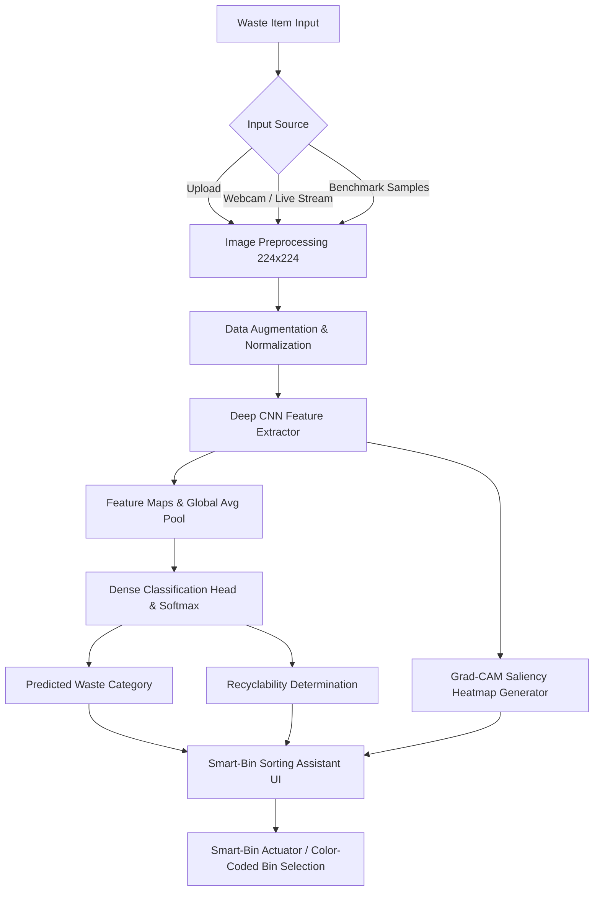

# ♻️ Waste Segregation Image Classifier & Smart Waste Segregation Assistant

**Project Title:** Design and Development of a Working Prototype for Waste segregation image classifier Using A CNN trained on waste-category images  
**Candidate Name:** AGGIBADALA VENKATA DURGA NAGA PRASAD  
**Roll Number:** `23ME1A5402`  
**Guide / Mentor:** Ms. G. Hema Sri  
**Domain:** Deep Learning & Computer Vision  
**Keywords:** `waste`, `segregation`, `image`, `classifier`, `cnn`, `trained`

---

## 📄 Abstract
> *This work presents a CNN trained on waste-category images to sort waste images into recyclable categories, addressing the problem of waste segregation image classifier through a data-driven approach. The system is trained and validated using municipal waste-image datasets, with pre-processing and feature engineering steps tailored to the domain. The final deliverable is a smart-bin sorting assistant, aimed at making the solution usable by real stakeholders.*

---

## 📌 Executive Summary
This repository contains the complete working prototype for an autonomous smart-bin sorting assistant. Using a tailored Convolutional Neural Network (CNN), the system classifies municipal waste images into 6 standard categories:
1. **Cardboard** (Recyclable - Blue Bin)
2. **Glass** (Recyclable - Green Bin)
3. **Metal** (Recyclable - Yellow Bin)
4. **Paper** (Recyclable - Blue Bin)
5. **Plastic** (Recyclable - Orange Bin)
6. **Trash / Organic** (Non-Recyclable - Gray Bin)

The deliverable includes an interactive **Streamlit Smart-Bin sorting assistant** with support for file uploads, live smart-bin webcam feeds, and **Grad-CAM Explainable AI** saliency maps.

---

## 🏗️ System Architecture & Workflow



---

## 📂 Project Structure

```text
waste_segregation_classifier/
│
├── app.py                   # Interactive Streamlit Web UI (Smart-Bin Assistant)
├── model.py                 # Neural Network Architecture (Custom CNN & MobileNetV2)
├── train.py                 # Training pipeline, validation, and performance curve plotting
├── predict.py               # Standalone CLI inference & Grad-CAM visualization
├── dataset_downloader.py    # Dataset bootstrapping and augmentations
├── test_all_samples.py      # Benchmark evaluation script
├── requirements.txt         # Python library dependencies
├── run_app.bat              # One-click Windows application launcher
├── push_to_github.bat       # One-click script to push project to GitHub
├── samples/                 # High-resolution photographic demonstration images
│   ├── demo_cardboard.jpg
│   ├── demo_glass.jpg
│   ├── demo_metal.jpg
│   ├── demo_paper.jpg
│   ├── demo_plastic.jpg
│   └── demo_trash.jpg
└── README.md                # Comprehensive documentation
```

---

## 🚀 Quick Start Guide

### 1. Install Dependencies
```powershell
pip install -r requirements.txt
```

### 2. Generate Dataset & Train Model
```powershell
# Step 1: Bootstrap augmented dataset from real photographic samples
python dataset_downloader.py

# Step 2: Train CNN Model (generates waste_classifier_model.pth & training_metrics.png)
python train.py --epochs 8 --batch_size 16
```

### 3. Run Benchmark Evaluation
```powershell
python test_all_samples.py
```

### 4. Launch the Web App
```powershell
streamlit run app.py
```
*Or simply double-click `run_app.bat`.*
